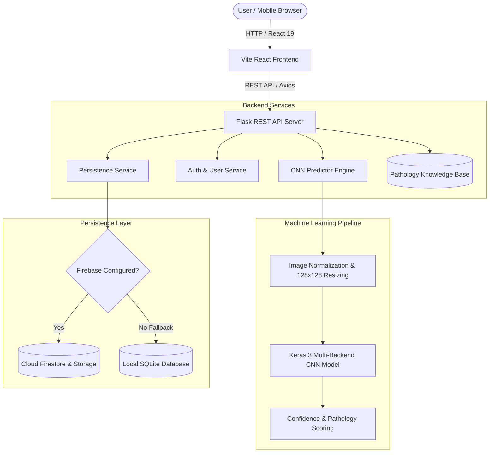

# PlantCare AI – Intelligent Plant Disease Detection System
## System Architecture & Technical Specification Document

---

## 1. Executive Overview

**PlantCare AI** is an enterprise-grade agricultural pathology diagnosis platform. It enables farmers, agronomists, extension specialists, and home gardeners to upload photographs of plant leaves and obtain instantaneous, deep learning-based disease classification alongside actionable Integrated Pest Management (IPM) protocols.

---

## 2. Technology Stack & Component Breakdown

### Frontend:
- **Framework:** React 19 (SPA with React Router DOM v7)
- **Bundler:** Vite 8 (Ultra-fast HMR and minified build pipeline)
- **Styling:** Tailwind CSS (Modern agricultural UI palette, responsive cards, glassmorphic headers)
- **Icons:** Lucide React (Clean, scalable SVG vector iconography)
- **Data Visualization:** Recharts (Interactive SVG Bar and Pie charts)
- **HTTP Client:** Axios (Interceptors, progress tracking, and multipart upload handling)
- **Unit Testing:** Vitest, React Testing Library, and jsdom

### Backend:
- **Framework:** Python Flask 3.1
- **API Architecture:** RESTful JSON endpoints with modular Blueprints
- **CORS:** Flask-CORS enabled with cross-origin credentials
- **Image Processing:** Pillow (PIL) 13.0
- **Configuration:** python-dotenv with centralized `config.py`
- **Testing:** Pytest and pytest-flask

### Machine Learning:
- **Core Framework:** Keras 3 with multi-backend compatibility (PyTorch/TensorFlow engines)
- **Neural Architecture:** Convolutional Neural Network (CNN) with Conv2D, BatchNormalization, MaxPooling2D, GlobalAveragePooling2D, Dropout, and Softmax
- **Scientific Stack:** NumPy, Pandas, Scikit-learn, Matplotlib, Seaborn
- **Input Dimensions:** 128 x 128 x 3 RGB normalized tensors
- **Optimization:** Adam Optimizer ($10^{-3}$ learning rate, ReduceLROnPlateau, EarlyStopping)

### Persistence & Security:
- **Cloud Mode:** Firebase Admin SDK (Cloud Firestore, Firebase Authentication, Cloud Storage)
- **Local Fallback:** High-performance SQLite database (`plantcare.db`) enabled by default without requiring external cloud credentials
- **Password Security:** Salted SHA-256 cryptographic hashing
- **Security Rules:** Granular user isolation rules in `firestore.rules`

---

## 3. Machine Learning Architecture

```mermaid
flowchart LR
    In["Input (128x128x3)"] --> Rescale["Rescaling (1/255)"]
    Rescale --> Aug["Data Augmentation (Flip/Rotation)"]
    Aug --> C1["Conv2D (32, 3x3) + BN + MaxPool"]
    C1 --> C2["Conv2D (64, 3x3) + BN + MaxPool"]
    C2 --> C3["Conv2D (128, 3x3) + BN + MaxPool"]
    C3 --> GAP["Global Average Pooling 2D"]
    GAP --> Dense1["Dense (128, ReLU)"]
    Dense1 --> Drop["Dropout (0.35)"]
    Drop --> Out["Dense (14 Classes, Softmax)"]
```

### Regularization Comparison:
1. **Basic CNN:** No kernel regularization or dropout. Faster initial training but prone to overfitting on small validation splits.
2. **L1 Regularization (Lasso):** Sparsity penalty ($10^{-4}$) forcing minor weights towards zero.
3. **L2 Regularization (Ridge):** Weight decay penalty ($10^{-4}$) preventing extreme parameter values.
4. **CNN with Dropout (0.35):** Stochastic node deactivation; delivers the highest test generalization.

---

## 4. API Endpoints Specification

| Method | Endpoint | Description | Request Payload | Response Code |
| :--- | :--- | :--- | :--- | :---: |
| `GET` | `/api/health` | Service health, uptime, platform diagnostics | None | `200 OK` |
| `GET` | `/api/model/info` | CNN model availability, framework, class catalog | None | `200 OK` |
| `POST` | `/api/predict` | Uploads foliar image for deep CNN pathology diagnosis | `multipart/form-data` (`image`) | `200 OK` / `400` / `413` |
| `GET` | `/api/history` | Retrieves logged foliar diagnoses | Query params: `limit`, `user_id` | `200 OK` |
| `GET` | `/api/dashboard/stats` | Aggregate outbreak metrics and distribution counts | None | `200 OK` |
| `POST` | `/api/auth/register` | Registers new user account | JSON: `{email, password, display_name}` | `201 Created` / `400` |
| `POST` | `/api/auth/login` | Authenticates user credentials | JSON: `{email, password}` | `200 OK` / `401` |
| `GET` | `/api/auth/status` | Reports active persistence mode | None | `200 OK` |

---

## 5. Security & Defensive Engineering

1. **Strict File Upload Validation:** File extension whitelist (`jpg`, `jpeg`, `png`, `webp`), binary magic number verification via Pillow, and 10MB payload size limit.
2. **Defensive Confidence Gating:** If model output probability is below 60%, the system flags a low-confidence warning instructing the user to upload clearer leaf imagery rather than hallucinating an incorrect disease.
3. **Dual Persistence Isolation:** In local SQLite mode, user records are isolated by `user_id`. In Firebase mode, `firestore.rules` enforces that only the authenticated user can read or modify their records.

